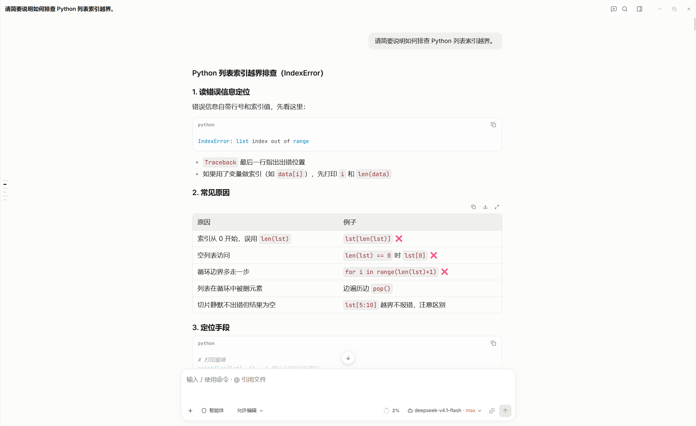
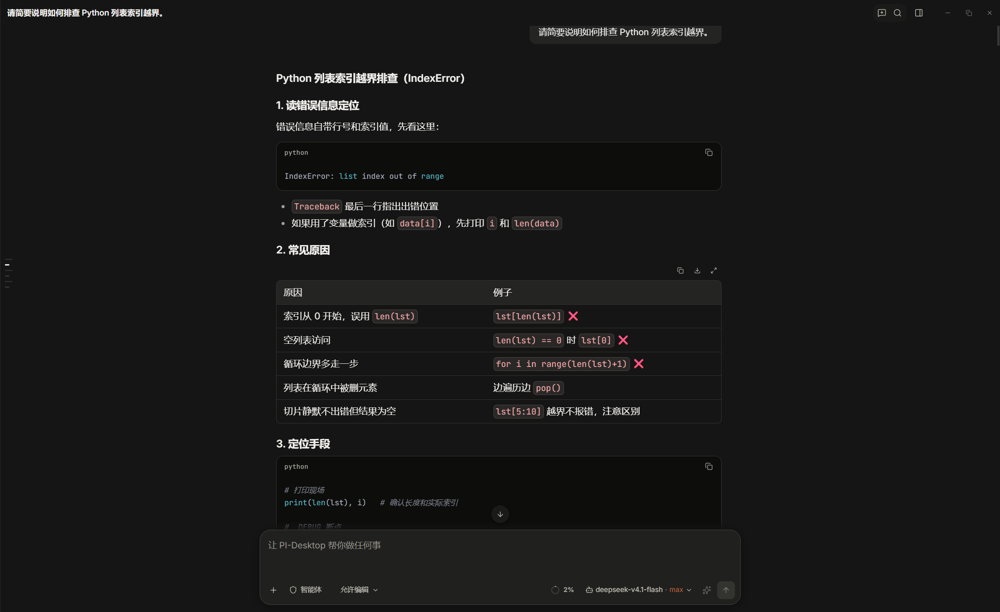

# Claude Theme

为 PI-Desktop 提供简洁、温和的 Claude 风格浅色与深色主题。

[插件市场](https://plugins.aiuo.net/plugins/io.github.b1eight.pi-desktop-claude-theme) · [下载与版本发布](https://github.com/B1eight/pi-desktop-claude-theme/releases) · [更新记录](CHANGELOG.md) · [问题反馈](https://github.com/B1eight/pi-desktop-claude-theme/issues)

## 效果预览

### Claude Theme Light



### Claude Theme Dark



## 安装与使用

推荐在 [PI-Desktop 插件市场](https://plugins.aiuo.net/plugins/io.github.b1eight.pi-desktop-claude-theme) 页面点击“下载 .piplug”，安装后确认 `ui.theme` 权限即可。

也可以直接在 [Releases](https://github.com/B1eight/pi-desktop-claude-theme/releases) 页下载 `.piplug` 安装包（不要下载自动生成的 Source code 压缩包），然后在 PI-Desktop 插件页面通过菜单选择“安装插件包”。

安装完成后，在主题设置中选择 **Claude Theme Light** 或 **Claude Theme Dark**。切换其他主题即可恢复。

需要 PI-Desktop **0.20.1 或更高版本**。插件 ID：`io.github.b1eight.pi-desktop-claude-theme`。

## 特点

- 浅色与深色两套配色，覆盖聊天、侧栏、设置和常用反馈界面。
- 排版使用系统字体族：西文 Segoe UI、中文 Noto Sans SC、等宽 Cascadia Code，不内嵌字体、无网络加载。中文族须排在 `system-ui` 之前，否则 Windows 上的 `system-ui` 会先以微软雅黑接管中文字形。
- 保留原生过程结构和折叠交互，不增加过程区整体外框，不截断正文。
- 仅使用 `ui.theme` 权限，无网络请求、工具注册或运行时 DOM 脚本。

主题只调整外观，不改变宿主业务行为。已在 PI-Desktop 0.21.0 上验证；未来宿主版本的兼容性以实际使用为准。

## 开发

需要 Node.js **24+**，无 npm 依赖。

```sh
npm run build
npm test
npm run verify
npm run check:roles
```

构建、浏览器测试与打包方式见 [开发说明](docs/DEVELOPMENT.md)。

## 许可与致谢

代码使用 [MIT](LICENSE)，保留 ebo、Caho1 的版权声明。部分设计参考 [Caho1/open-claude-ui](https://github.com/Caho1/open-claude-ui)（提交 `2834bc158a4849f21c97cbb2e0b10525f6e646f1`）。本版本不再随包分发字体，详见 [字体说明](assets/README.md)。

本项目是非官方主题，不隶属于 Anthropic，也未获其背书；不包含其专有字体、logo 或官方产品代码。
