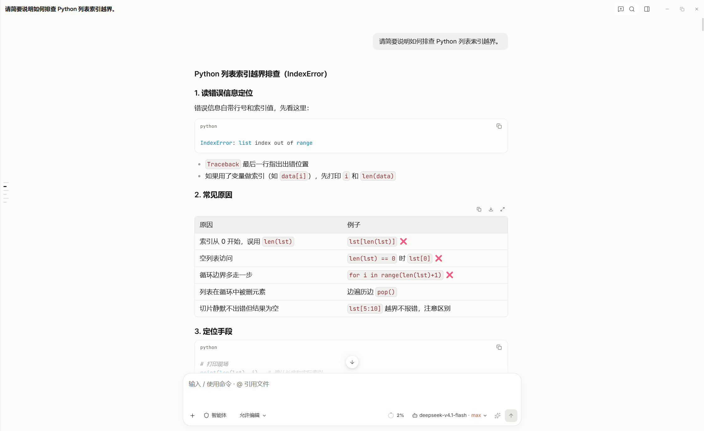
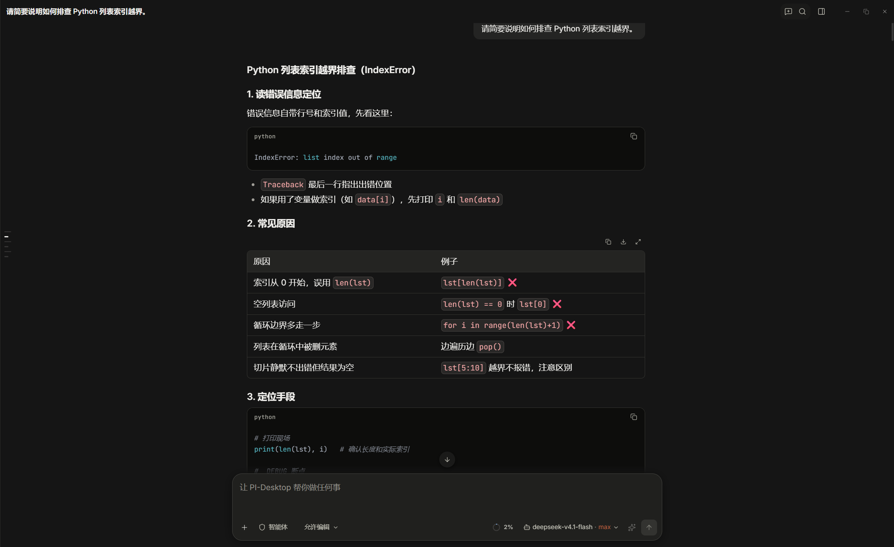

# Claude Theme

为 PI-Desktop 提供简洁、温和的 Claude 风格浅色与深色主题。

[插件市场](https://plugins.aiuo.net/plugins/io.github.b1eight.pi-desktop-claude-theme) · [下载与版本发布](https://github.com/B1eight/pi-desktop-claude-theme/releases) · [更新记录](CHANGELOG.md) · [问题反馈](https://github.com/B1eight/pi-desktop-claude-theme/issues)

## 效果预览

以下为 1.0.2 的实际宿主截图；1.1.0 的圆角、字体、弱化文字与动效变化见下方特点及更新记录。

### Claude Theme Light



### Claude Theme Dark



## 安装与使用

推荐在 [PI-Desktop 插件市场](https://plugins.aiuo.net/plugins/io.github.b1eight.pi-desktop-claude-theme) 页面点击“下载 .piplug”，安装后确认 `ui.theme` 权限即可。

也可以直接在 [Releases](https://github.com/B1eight/pi-desktop-claude-theme/releases) 页下载 `.piplug` 安装包（不要下载自动生成的 Source code 压缩包），然后在 PI-Desktop 插件页面通过菜单选择“安装插件包”。

安装完成后，在主题设置中选择 **Claude Theme Light** 或 **Claude Theme Dark**。切换其他主题即可恢复。

需要 PI-Desktop **0.20.1 或更高版本**。插件 ID：`io.github.b1eight.pi-desktop-claude-theme`。声明的最低版本不等于逐版验收：1.1.0 的真机验收基线是 **0.22.0**，0.20.1–0.21.x 未单独验收。

## 特点

- 浅色与深色两套配色，覆盖聊天、侧栏、设置和常用反馈界面；输入框 12px、用户气泡 14px、模态框 10px，与 Claude 原生档位一致。
- UI 使用平台优先的系统无衬线字体，回复正文使用独立的人文衬线回退栈，代码保持等宽字体；无内嵌字体或网络加载，实际字形取决于已安装字体。
- 区分文字陶土色与状态/聚焦陶土色，采用细内环、柔和光晕和单层容器边界。
- 采用视觉优先的弱化文字：faint 与 placeholder 在指定页面/输入框背景上的对比度目标为 2.8:1–3.6:1；这不是 WCAG 豁免或整套主题的无障碍符合性声明。
- 加入 70ms 按压微缩、CSS 弹簧近似、滚动边缘渐隐和运行态呼吸/微光；遵循减少动态效果与强制色设置。
- 保留原生过程结构、折叠交互和滚动定位，不增加过程区整体外框，不截断正文；仅使用 `ui.theme`，无运行时 DOM 脚本。

主题只调整外观，不改变宿主业务行为。真机验收宿主为 PI-Desktop **0.22.0**；构建与合成浏览器检查不能替代实际安装体验，未来宿主版本的兼容性以实际使用为准。验收覆盖到哪一步见 [验收状态目录](docs/acceptance-states.json) 与 `npm run check:acceptance`，未标注真实宿主证据的状态一律算未验收。

## 开发

需要 Node.js **24+**，无 npm 依赖。

```sh
npm run build
npm test
npm run verify
npm run check:roles
```

构建、浏览器测试与打包方式见 [开发说明](docs/DEVELOPMENT.md)。

## 许可与致谢

代码使用 [MIT](LICENSE)，保留 ebo、Caho1 的版权声明。部分设计参考 [Caho1/open-claude-ui](https://github.com/Caho1/open-claude-ui)（提交 `2834bc158a4849f21c97cbb2e0b10525f6e646f1`）。本版本不再随包分发字体，详见 [字体说明](assets/README.md)。

本项目是非官方主题，不隶属于 Anthropic，也未获其背书；不包含其专有字体、logo 或官方产品代码。
